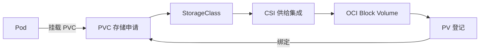

# 25 PVC、CSI、PV 与 OCI Block Volume

把通用存储接口映射到 OCI 的实际持久卷。



## 核心要点

- **1. PVC 自己保存数据库文件吗？** 不是。它表达存储申请并绑定 PV；真实数据保存在后端卷上。CSI 集成连接 Kubernetes 与 OCI 存储服务。
- **2. 为什么有 CSI 这一层？** Kubernetes 使用通用接口对接不同存储系统。OCI 实现把申请转化为相应 Block Volume 操作，而不要求 Kubernetes 只认识一家云。
- **3. 示例为什么明确写 oci-bv？** 它是条件性示例类名，必须在实际集群中存在且具备相应供给能力。应先查询 StorageClass，不保证每个 OKE 都有同一名称或配置。
- **4. Bound 代表程序已经开始正常读写吗？** 不是。它说明 PVC 已绑定 PV，后续还要挂载、容器启动和实际文件或数据库读写验证。
- **5. 数据必须一直保留，除了绑定还看什么？** 还要看访问模式、底层存储、回收策略与备份。本课程围绕 Managed Nodes 说明 Block Volume，不直接套到所有节点模式。

## 场景与示例

**50Gi 的条件性存储申请**

examples 中提供 database-pvc 和消费者，先具备实际 oci-bv 类，再创建；没有运行真实数据库，只用文件演示挂载关系。

```yaml
apiVersion: v1
kind: PersistentVolumeClaim
metadata:
  name: database-pvc
  namespace: oke-cloud-examples
spec:
  storageClassName: oci-bv
  accessModes: ["ReadWriteOnce"]
  resources:
    requests:
      storage: 50Gi
```

先查询 StorageClass。消费者文件在 examples/storage-consumer-conditional.yaml，若采用延迟绑定，应让消费者参与调度后继续观察。

## 常见误区

**Bound 就等于数据库已经健康**

绑定、挂载、应用就绪和业务读写属于连续但不同的检查点。

## 来源与学习衔接

本章基于用户提供的 Terraform + OCI + OKE 教材重新组织。输入代码块缺失，末尾在负载均衡扩展段落截断；全部完整代码、命令和实验步骤为补充，不是原文代码复原。官方核对依据见 [来源与补充说明.md](来源与补充说明.md)。

下一章：Terraform 磁盘与 PVC 动态卷的所有权。

---

## 本章测验

本章共 5 道单项选择题，每题 1 分。先自行选择，再展开答案；支持 QUIZ_DATA 的播放器应在选择后判题。

### 第 1 题

PVC 的角色是什么？

- A. 真实数据库进程
- B. 存储申请与绑定对象
- C. 云网络入口
- D. 容器镜像仓库

<details>
<summary>选择完成后展开答案</summary>

正确答案：B

答案解析：不是。它表达存储申请并绑定 PV；真实数据保存在后端卷上。CSI 集成连接 Kubernetes 与 OCI 存储服务。

</details>

### 第 2 题

CSI 的核心意义是什么？

- A. OCI 专用 Pod 标签
- B. Terraform 资源显示名
- C. 一种 HTTP 路由规则
- D. 通用的容器存储集成接口

<details>
<summary>选择完成后展开答案</summary>

正确答案：D

答案解析：Kubernetes 使用通用接口对接不同存储系统。OCI 实现把申请转化为相应 Block Volume 操作，而不要求 Kubernetes 只认识一家云。

</details>

### 第 3 题

使用 oci-bv 前先确认什么？

- A. 所有 Region 都叫同名
- B. 所有 Pod 都在公网
- C. 实际 StorageClass 存在且可供给
- D. Namespace 名等于 oci-bv

<details>
<summary>选择完成后展开答案</summary>

正确答案：C

答案解析：它是条件性示例类名，必须在实际集群中存在且具备相应供给能力。应先查询 StorageClass，不保证每个 OKE 都有同一名称或配置。

</details>

### 第 4 题

PVC 为 Bound 能直接说明什么？

- A. 已建立 PVC 与 PV 绑定
- B. 应用数据库已完成读写
- C. 全部数据已自动备份
- D. Node 已获得公网地址

<details>
<summary>选择完成后展开答案</summary>

正确答案：A

答案解析：不是。它说明 PVC 已绑定 PV，后续还要挂载、容器启动和实际文件或数据库读写验证。

</details>

### 第 5 题

测试持久化应检查什么实际结果？

- A. 只看到 PVC 名称
- B. 只看到 LB 地址
- C. 只看到 Terraform 文件存在
- D. 重建消费者后读到原数据

<details>
<summary>选择完成后展开答案</summary>

正确答案：D

答案解析：还要看访问模式、底层存储、回收策略与备份。本课程围绕 Managed Nodes 说明 Block Volume，不直接套到所有节点模式。

</details>

<!-- QUIZ_DATA_START
{
  "chapter": "25",
  "questions": [
    {
      "id": 1,
      "question": "PVC 的角色是什么？",
      "options": {
        "A": "真实数据库进程",
        "B": "存储申请与绑定对象",
        "C": "云网络入口",
        "D": "容器镜像仓库"
      },
      "answer": "B",
      "explanation": "不是。它表达存储申请并绑定 PV；真实数据保存在后端卷上。CSI 集成连接 Kubernetes 与 OCI 存储服务。"
    },
    {
      "id": 2,
      "question": "CSI 的核心意义是什么？",
      "options": {
        "A": "OCI 专用 Pod 标签",
        "B": "Terraform 资源显示名",
        "C": "一种 HTTP 路由规则",
        "D": "通用的容器存储集成接口"
      },
      "answer": "D",
      "explanation": "Kubernetes 使用通用接口对接不同存储系统。OCI 实现把申请转化为相应 Block Volume 操作，而不要求 Kubernetes 只认识一家云。"
    },
    {
      "id": 3,
      "question": "使用 oci-bv 前先确认什么？",
      "options": {
        "A": "所有 Region 都叫同名",
        "B": "所有 Pod 都在公网",
        "C": "实际 StorageClass 存在且可供给",
        "D": "Namespace 名等于 oci-bv"
      },
      "answer": "C",
      "explanation": "它是条件性示例类名，必须在实际集群中存在且具备相应供给能力。应先查询 StorageClass，不保证每个 OKE 都有同一名称或配置。"
    },
    {
      "id": 4,
      "question": "PVC 为 Bound 能直接说明什么？",
      "options": {
        "A": "已建立 PVC 与 PV 绑定",
        "B": "应用数据库已完成读写",
        "C": "全部数据已自动备份",
        "D": "Node 已获得公网地址"
      },
      "answer": "A",
      "explanation": "不是。它说明 PVC 已绑定 PV，后续还要挂载、容器启动和实际文件或数据库读写验证。"
    },
    {
      "id": 5,
      "question": "测试持久化应检查什么实际结果？",
      "options": {
        "A": "只看到 PVC 名称",
        "B": "只看到 LB 地址",
        "C": "只看到 Terraform 文件存在",
        "D": "重建消费者后读到原数据"
      },
      "answer": "D",
      "explanation": "还要看访问模式、底层存储、回收策略与备份。本课程围绕 Managed Nodes 说明 Block Volume，不直接套到所有节点模式。"
    }
  ]
}
QUIZ_DATA_END -->
