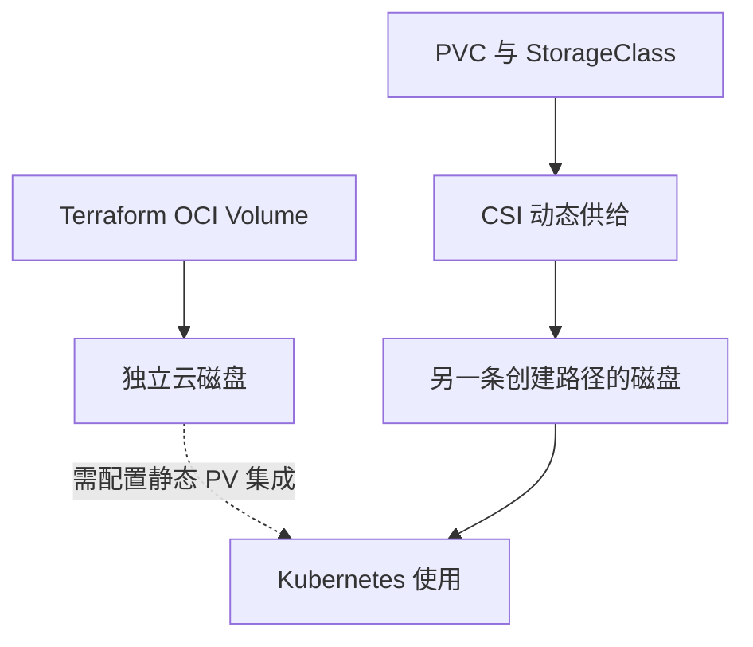

# 26 Terraform 磁盘与 PVC 动态卷的所有权

避免独立创建两块磁盘却误认为它们是同一资源。

## 核心要点

- **1. Terraform 能直接创建 Block Volume 吗？** 可以，使用 OCI 存储资源声明。但一个云磁盘存在，不表示 Kubernetes 已有对应 PV、PVC 或挂载关系。
- **2. 静态使用已有磁盘与动态申请有什么区别？** 前者需要配置对应 PV 与集成信息；后者通过 PVC、StorageClass 和 CSI 供给卷。它们的声明与资源归属路径不同。
- **3. 两条路径都创建五十 Gi 就是同一块吗？** 不是。容量相同不建立身份关联，需要看实际卷 ID 和 PV 对应关系，否则可能创建两块不同的存储。
- **4. 清理应用时为什么需要看回收策略？** 删除 PVC 可能依据 PV 回收策略影响云卷，独立 Terraform 卷又有自己的删除计划。持久化不是任何删除都保留的保证。
- **5. 如何规划日常应用存储管理？** 明确由 Terraform 独立管理还是由 CSI 动态供给，再设计应用引用和备份。不能把两套创建路径混成一个未经绑定的存储。

## 场景与示例

**数据库需要一块长期磁盘**

先选择并说明供给路径；若已有磁盘要复用，应明确 PV 与实际卷的集成，而不是再申请一块动态卷。

## 常见误区

**同名或同容量就自动建立磁盘关联**

关联依据实际身份和明确配置，不依据显示文字碰巧相同。

## 来源与学习衔接

本章基于用户提供的 Terraform + OCI + OKE 教材重新组织。输入代码块缺失，末尾在负载均衡扩展段落截断；全部完整代码、命令和实验步骤为补充，不是原文代码复原。官方核对依据见 [来源与补充说明.md](来源与补充说明.md)。

下一章：五种工作负载在 OKE 中的选择。

---

## 本章测验

本章共 5 道单项选择题，每题 1 分。先自行选择，再展开答案；支持 QUIZ_DATA 的播放器应在选择后判题。

### 第 1 题

直接创建云磁盘能自动得到 PVC 吗？

- A. 能，所有云磁盘都会注册为 PVC
- B. 能，Compartment 自动创建 Namespace
- C. 不能，还需适当存储集成
- D. 能，磁盘名字会变成 Service

选择完成后展开答案

正确答案：C

答案解析：可以，使用 OCI 存储资源声明。但一个云磁盘存在，不表示 Kubernetes 已有对应 PV、PVC 或挂载关系。

### 第 2 题

动态卷通常从哪条路径开始？

- A. PVC 与 StorageClass
- B. 仅一个独立 OCI Volume resource
- C. 仅一条 CoreDNS 记录
- D. 仅一个 Ingress host

选择完成后展开答案

正确答案：A

答案解析：前者需要配置对应 PV 与集成信息；后者通过 PVC、StorageClass 和 CSI 供给卷。它们的声明与资源归属路径不同。

### 第 3 题

两块容量相同的卷怎样判断是否同一个资源？

- A. 仅比较容量数字
- B. 仅比较创建日期
- C. 仅比较命名空间颜色
- D. 核对实际 ID 与绑定关系

选择完成后展开答案

正确答案：D

答案解析：不是。容量相同不建立身份关联，需要看实际卷 ID 和 PV 对应关系，否则可能创建两块不同的存储。

### 第 4 题

删除 PVC 后要关注什么？

- A. 只看 Pod 端口号
- B. PV 回收策略与实际云卷处理
- C. 只看 Terraform 文件名
- D. 只看镜像标签长度

选择完成后展开答案

正确答案：B

答案解析：删除 PVC 可能依据 PV 回收策略影响云卷，独立 Terraform 卷又有自己的删除计划。持久化不是任何删除都保留的保证。

### 第 5 题

避免重复创建存储的关键是什么？

- A. 明确创建者、实际身份和使用关联
- B. 永远给所有卷相同名字
- C. 删除所有 State 文件
- D. 把 PVC 类型改成 Service

选择完成后展开答案

正确答案：A

答案解析：明确由 Terraform 独立管理还是由 CSI 动态供给，再设计应用引用和备份。不能把两套创建路径混成一个未经绑定的存储。

<!-- QUIZ_DATA_START
{
  "chapter": "26",
  "questions": [
    {
      "id": 1,
      "question": "直接创建云磁盘能自动得到 PVC 吗？",
      "options": {
        "A": "能，所有云磁盘都会注册为 PVC",
        "B": "能，Compartment 自动创建 Namespace",
        "C": "不能，还需适当存储集成",
        "D": "能，磁盘名字会变成 Service"
      },
      "answer": "C",
      "explanation": "可以，使用 OCI 存储资源声明。但一个云磁盘存在，不表示 Kubernetes 已有对应 PV、PVC 或挂载关系。"
    },
    {
      "id": 2,
      "question": "动态卷通常从哪条路径开始？",
      "options": {
        "A": "PVC 与 StorageClass",
        "B": "仅一个独立 OCI Volume resource",
        "C": "仅一条 CoreDNS 记录",
        "D": "仅一个 Ingress host"
      },
      "answer": "A",
      "explanation": "前者需要配置对应 PV 与集成信息；后者通过 PVC、StorageClass 和 CSI 供给卷。它们的声明与资源归属路径不同。"
    },
    {
      "id": 3,
      "question": "两块容量相同的卷怎样判断是否同一个资源？",
      "options": {
        "A": "仅比较容量数字",
        "B": "仅比较创建日期",
        "C": "仅比较命名空间颜色",
        "D": "核对实际 ID 与绑定关系"
      },
      "answer": "D",
      "explanation": "不是。容量相同不建立身份关联，需要看实际卷 ID 和 PV 对应关系，否则可能创建两块不同的存储。"
    },
    {
      "id": 4,
      "question": "删除 PVC 后要关注什么？",
      "options": {
        "A": "只看 Pod 端口号",
        "B": "PV 回收策略与实际云卷处理",
        "C": "只看 Terraform 文件名",
        "D": "只看镜像标签长度"
      },
      "answer": "B",
      "explanation": "删除 PVC 可能依据 PV 回收策略影响云卷，独立 Terraform 卷又有自己的删除计划。持久化不是任何删除都保留的保证。"
    },
    {
      "id": 5,
      "question": "避免重复创建存储的关键是什么？",
      "options": {
        "A": "明确创建者、实际身份和使用关联",
        "B": "永远给所有卷相同名字",
        "C": "删除所有 State 文件",
        "D": "把 PVC 类型改成 Service"
      },
      "answer": "A",
      "explanation": "明确由 Terraform 独立管理还是由 CSI 动态供给，再设计应用引用和备份。不能把两套创建路径混成一个未经绑定的存储。"
    }
  ]
}
QUIZ_DATA_END -->
