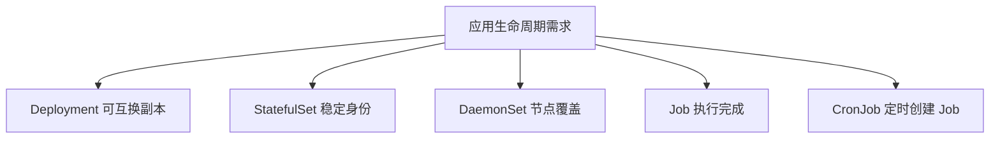

# 27 五种工作负载在 OKE 中的选择

按副本可互换性、节点覆盖和任务完成方式选择资源。



## 核心要点

- **1. 部署到 OKE 会改变 Deployment 的职责吗？** 不会。可互换的长期 Web 或 API 副本仍适合 Deployment，云上的节点供给与工作负载选择属于不同层次。
- **2. StatefulSet 为什么适合稳定身份？** 它管理序号、可预测网络身份与对应存储，适用于有这些需求的应用。但数据库复制和切换仍要应用系统自己实现。
- **3. 节点日志代理用什么？** DaemonSet 在符合条件的节点上运行代理，数量随节点覆盖需求变化。它与固定总副本目标的 Deployment 不同。
- **4. 一次批处理与定时批处理怎样分？** 一次直到完成用 Job，按时间表创建 Job 用 CronJob；实际任务仍需考虑重试和幂等。定时规则还应明确解释时区。
- **5. 五种控制器有没有帮我选云机器类型？** 它们表达应用生命周期，Node Pool 与云资源配置表达执行基础设施。实际运行结果还要同时满足容量、镜像、网络与存储条件。

## 场景与示例

**同一 OKE 中混合应用**

Web 用 Deployment，节点代理用 DaemonSet，批处理用 Job 或 CronJob；只有需要稳定身份时才引入 StatefulSet。

```yaml
apiVersion: batch/v1
kind: CronJob
metadata:
  name: daily-demo
  namespace: oke-cloud-examples
spec:
  schedule: "0 2 * * *"
  timeZone: "Asia/Tokyo"
  concurrencyPolicy: Forbid
  jobTemplate:
    spec:
      template:
        spec:
          restartPolicy: Never
          containers:
            - name: task
              image: busybox:1.37
              command: ["sh", "-c", "echo scheduled-demo"]
```

演示每天日本时间两点创建任务，仅输出文本，不执行真实数据处理。Job 需要幂等，Forbid 不等于精确执行一次。

## 常见误区

**所有数据库都必须用 StatefulSet，且会自动高可用**

应根据架构选生命周期机制；数据库复制与高可用需要专门实现。

## 来源与学习衔接

本章基于用户提供的 Terraform + OCI + OKE 教材重新组织。输入代码块缺失，末尾在负载均衡扩展段落截断；全部完整代码、命令和实验步骤为补充，不是原文代码复原。官方核对依据见 [来源与补充说明.md](来源与补充说明.md)。

下一章：完整实验：已有 OKE 上的 Terraform Nginx。

---

## 本章测验

本章共 5 道单项选择题，每题 1 分。先自行选择，再展开答案；支持 QUIZ_DATA 的播放器应在选择后判题。

### 第 1 题

可互换长期 Web 副本通常选择什么？

- A. CronJob
- B. PVC
- C. ExternalName
- D. Deployment

<details>
<summary>选择完成后展开答案</summary>

正确答案：D

答案解析：不会。可互换的长期 Web 或 API 副本仍适合 Deployment，云上的节点供给与工作负载选择属于不同层次。

</details>

### 第 2 题

StatefulSet 不能仅凭自身保证什么？

- A. 稳定序号身份管理
- B. 数据库内部复制和业务一致性
- C. 对应存储管理机制
- D. 可预测 Pod 网络身份机制

<details>
<summary>选择完成后展开答案</summary>

正确答案：B

答案解析：它管理序号、可预测网络身份与对应存储，适用于有这些需求的应用。但数据库复制和切换仍要应用系统自己实现。

</details>

### 第 3 题

每个合适 Node 一份代理通常选什么？

- A. DaemonSet
- B. ClusterIP Service
- C. ConfigMap
- D. 一次性 Job

<details>
<summary>选择完成后展开答案</summary>

正确答案：A

答案解析：DaemonSet 在符合条件的节点上运行代理，数量随节点覆盖需求变化。它与固定总副本目标的 Deployment 不同。

</details>

### 第 4 题

每天日本时间两点运行，哪个组合更合理？

- A. Deployment 配固定两个副本
- B. PV 配五十 Gi
- C. CronJob 配时间表和 Asia/Tokyo
- D. Node Pool 配东京显示名

<details>
<summary>选择完成后展开答案</summary>

正确答案：C

答案解析：一次直到完成用 Job，按时间表创建 Job 用 CronJob；实际任务仍需考虑重试和幂等。定时规则还应明确解释时区。

</details>

### 第 5 题

选择工作负载后还要关注什么？

- A. 仅把所有资源改成同名
- B. 节点与应用实际运行条件
- C. 不再关心任何镜像路径
- D. 默认获得全部业务备份

<details>
<summary>选择完成后展开答案</summary>

正确答案：B

答案解析：它们表达应用生命周期，Node Pool 与云资源配置表达执行基础设施。实际运行结果还要同时满足容量、镜像、网络与存储条件。

</details>

<!-- QUIZ_DATA_START
{
  "chapter": "27",
  "questions": [
    {
      "id": 1,
      "question": "可互换长期 Web 副本通常选择什么？",
      "options": {
        "A": "CronJob",
        "B": "PVC",
        "C": "ExternalName",
        "D": "Deployment"
      },
      "answer": "D",
      "explanation": "不会。可互换的长期 Web 或 API 副本仍适合 Deployment，云上的节点供给与工作负载选择属于不同层次。"
    },
    {
      "id": 2,
      "question": "StatefulSet 不能仅凭自身保证什么？",
      "options": {
        "A": "稳定序号身份管理",
        "B": "数据库内部复制和业务一致性",
        "C": "对应存储管理机制",
        "D": "可预测 Pod 网络身份机制"
      },
      "answer": "B",
      "explanation": "它管理序号、可预测网络身份与对应存储，适用于有这些需求的应用。但数据库复制和切换仍要应用系统自己实现。"
    },
    {
      "id": 3,
      "question": "每个合适 Node 一份代理通常选什么？",
      "options": {
        "A": "DaemonSet",
        "B": "ClusterIP Service",
        "C": "ConfigMap",
        "D": "一次性 Job"
      },
      "answer": "A",
      "explanation": "DaemonSet 在符合条件的节点上运行代理，数量随节点覆盖需求变化。它与固定总副本目标的 Deployment 不同。"
    },
    {
      "id": 4,
      "question": "每天日本时间两点运行，哪个组合更合理？",
      "options": {
        "A": "Deployment 配固定两个副本",
        "B": "PV 配五十 Gi",
        "C": "CronJob 配时间表和 Asia/Tokyo",
        "D": "Node Pool 配东京显示名"
      },
      "answer": "C",
      "explanation": "一次直到完成用 Job，按时间表创建 Job 用 CronJob；实际任务仍需考虑重试和幂等。定时规则还应明确解释时区。"
    },
    {
      "id": 5,
      "question": "选择工作负载后还要关注什么？",
      "options": {
        "A": "仅把所有资源改成同名",
        "B": "节点与应用实际运行条件",
        "C": "不再关心任何镜像路径",
        "D": "默认获得全部业务备份"
      },
      "answer": "B",
      "explanation": "它们表达应用生命周期，Node Pool 与云资源配置表达执行基础设施。实际运行结果还要同时满足容量、镜像、网络与存储条件。"
    }
  ]
}
QUIZ_DATA_END -->
