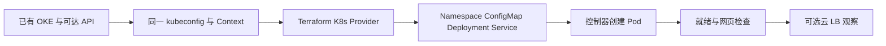

# 28 完整实验：已有 OKE 上的 Terraform Nginx

用可审阅工程验证 Provider、应用配置与本地访问。

## 核心要点

- **1. 这个完整实验是否从零创建 OKE？** 不是。它要求已有可用 OKE 和工作节点，用 Kubernetes Provider 管理应用。独立 VCN 示例不负责提供实验集群。
- **2. Terraform 显式创建哪四种资源？** Namespace、ConfigMap、Deployment、Service。ReplicaSet 和 Pod 由 Kubernetes 控制器创建，默认 Service 为 ClusterIP。
- **3. 实验步骤为什么先做上下文检查？** Terraform 与 kubectl 使用相同 kubeconfig 和 Context，先确认能够查询学习集群，再 init、validate、plan 和 apply。不要无意识采用默认目标。
- **4. 怎样验证实验真正到达用户请求？** 先确认两个 Pod 就绪，再保持 port-forward 终端运行，浏览器访问 localhost:8080。预期网页来自 ConfigMap 中的 index.html，但需要实际请求确认。
- **5. 最后怎样清理？** 先审阅应用工程的删除计划，确认 Namespace 仅有自己的实验对象，再执行清理。若做过 LoadBalancer 扩展，还要确认关联 OCI LB 已正确清理。

## 场景与示例

**一个可自行执行的完整应用工程**

terraform/oke-nginx 保存版本、变量、Provider、主资源与输出；实验步骤.md 给出 PowerShell 命令和检查点。本次制作只做本地验证，不访问真实集群。

完整步骤：[实验步骤.md](实验步骤.md)。完整应用工程：[terraform/oke-nginx/main.tf](terraform/oke-nginx/main.tf)。默认仅创建 ClusterIP Service，不自动创建 OCI LB。

## 常见误区

**这个实验成功就证明完整基础设施工程已经部署**

它只验证已有集群上的应用交付，不能替代从零 OKE 网络和节点验证。

## 来源与学习衔接

本章基于用户提供的 Terraform + OCI + OKE 教材重新组织。输入代码块缺失，末尾在负载均衡扩展段落截断；全部完整代码、命令和实验步骤为补充，不是原文代码复原。官方核对依据见 [来源与补充说明.md](来源与补充说明.md)。

下一章：全系统回顾：创建链、访问链与所有权。

---

## 本章测验

本章共 5 道单项选择题，每题 1 分。先自行选择，再展开答案；支持 QUIZ_DATA 的播放器应在选择后判题。

### 第 1 题

本实验的基础设施前提是什么？

- A. 已有可用 OKE 与工作节点
- B. 仅存在一个空 VCN
- C. 仅安装浏览器
- D. 仅创建 OCIR 仓库

选择完成后展开答案

正确答案：A

答案解析：不是。它要求已有可用 OKE 和工作节点，用 Kubernetes Provider 管理应用。独立 VCN 示例不负责提供实验集群。

### 第 2 题

本实验显式资源组合是什么？

- A. VCN、Subnet、OKE、Node Pool
- B. Region、AD、Compute、Block Volume
- C. Namespace、ConfigMap、Deployment、Service
- D. Ingress、Controller、LB、VPN

选择完成后展开答案

正确答案：C

答案解析：Namespace、ConfigMap、Deployment、Service。ReplicaSet 和 Pod 由 Kubernetes 控制器创建，默认 Service 为 ClusterIP。

### 第 3 题

实际变更前最先确认哪组条件？

- A. 仅网页标题与颜色
- B. 目标集群、认证与 API 网络可达
- C. 仅 ZIP 文件名
- D. 仅 Deployment 的名称长度

选择完成后展开答案

正确答案：B

答案解析：Terraform 与 kubectl 使用相同 kubeconfig 和 Context，先确认能够查询学习集群，再 init、validate、plan 和 apply。不要无意识采用默认目标。

### 第 4 题

哪项是最终应用验证的一部分？

- A. 仅 terraform fmt 通过
- B. 仅 Provider 已下载
- C. 仅示例变量文件存在
- D. 读到预期网页响应

选择完成后展开答案

正确答案：D

答案解析：先确认两个 Pod 就绪，再保持 port-forward 终端运行，浏览器访问 localhost:8080。预期网页来自 ConfigMap 中的 index.html，但需要实际请求确认。

### 第 5 题

清理前应重点检查什么？

- A. 只看两个 Pod 名称相同
- B. 只看浏览器已关闭
- C. 工程范围、Namespace 内容与云侧关联
- D. 只看 State 文件大小

选择完成后展开答案

正确答案：C

答案解析：先审阅应用工程的删除计划，确认 Namespace 仅有自己的实验对象，再执行清理。若做过 LoadBalancer 扩展，还要确认关联 OCI LB 已正确清理。

<!-- QUIZ_DATA_START
{
  "chapter": "28",
  "questions": [
    {
      "id": 1,
      "question": "本实验的基础设施前提是什么？",
      "options": {
        "A": "已有可用 OKE 与工作节点",
        "B": "仅存在一个空 VCN",
        "C": "仅安装浏览器",
        "D": "仅创建 OCIR 仓库"
      },
      "answer": "A",
      "explanation": "不是。它要求已有可用 OKE 和工作节点，用 Kubernetes Provider 管理应用。独立 VCN 示例不负责提供实验集群。"
    },
    {
      "id": 2,
      "question": "本实验显式资源组合是什么？",
      "options": {
        "A": "VCN、Subnet、OKE、Node Pool",
        "B": "Region、AD、Compute、Block Volume",
        "C": "Namespace、ConfigMap、Deployment、Service",
        "D": "Ingress、Controller、LB、VPN"
      },
      "answer": "C",
      "explanation": "Namespace、ConfigMap、Deployment、Service。ReplicaSet 和 Pod 由 Kubernetes 控制器创建，默认 Service 为 ClusterIP。"
    },
    {
      "id": 3,
      "question": "实际变更前最先确认哪组条件？",
      "options": {
        "A": "仅网页标题与颜色",
        "B": "目标集群、认证与 API 网络可达",
        "C": "仅 ZIP 文件名",
        "D": "仅 Deployment 的名称长度"
      },
      "answer": "B",
      "explanation": "Terraform 与 kubectl 使用相同 kubeconfig 和 Context，先确认能够查询学习集群，再 init、validate、plan 和 apply。不要无意识采用默认目标。"
    },
    {
      "id": 4,
      "question": "哪项是最终应用验证的一部分？",
      "options": {
        "A": "仅 terraform fmt 通过",
        "B": "仅 Provider 已下载",
        "C": "仅示例变量文件存在",
        "D": "读到预期网页响应"
      },
      "answer": "D",
      "explanation": "先确认两个 Pod 就绪，再保持 port-forward 终端运行，浏览器访问 localhost:8080。预期网页来自 ConfigMap 中的 index.html，但需要实际请求确认。"
    },
    {
      "id": 5,
      "question": "清理前应重点检查什么？",
      "options": {
        "A": "只看两个 Pod 名称相同",
        "B": "只看浏览器已关闭",
        "C": "工程范围、Namespace 内容与云侧关联",
        "D": "只看 State 文件大小"
      },
      "answer": "C",
      "explanation": "先审阅应用工程的删除计划，确认 Namespace 仅有自己的实验对象，再执行清理。若做过 LoadBalancer 扩展，还要确认关联 OCI LB 已正确清理。"
    }
  ]
}
QUIZ_DATA_END -->
