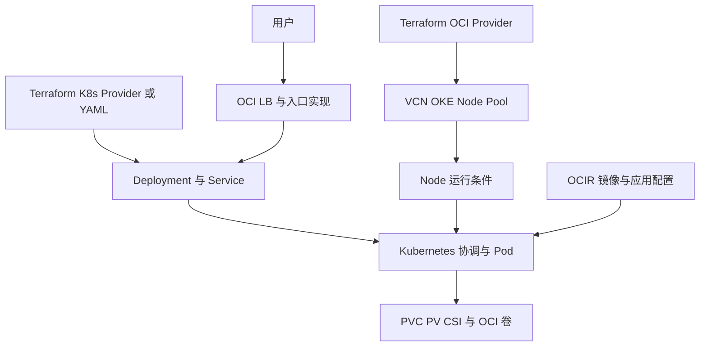

# 29 全系统回顾：创建链、访问链与所有权

分开说明谁创建、谁协调、谁处理请求与谁保存数据。

## 核心要点

- **1. 学习主线可以怎么复述？** 先准备云网络和集群节点，再准备客户端连接，用应用声明提交目标，Kubernetes 在节点上运行容器。访问和持久化还需要各自的关联资源。
- **2. 两类状态为什么必须继续分清？** Terraform State 描述其管理映射，Kubernetes API 状态支撑持续协调。云控制器和 CSI 可能供给不在 Terraform 直接清单里的云资源。
- **3. 访问链怎么讲清？** 用户到云入口与路由实现，再到 Service 后端与应用。管理 API、镜像拉取、业务请求与存储读写是不同流量，不要混成一条路径。
- **4. 保留数据时回到哪些对象？** 回到 PVC、PV、CSI 与真实卷，核对创建者、绑定和回收，再安排备份。Bound、Pod Running 或同容量都不能单独证明业务数据安全。
- **5. 后面可以继续研究什么？** 可以继续学习完整 OKE 网络模块、Backend 协作、节点容量与探针、入口方案和数据库备份；本课不把这些方向说成已实现工程。

## 场景与示例

**三个启发式问题**

谁直接管理这个对象？目标与实际之间由谁协调？对象删除后其关联云入口或存储会怎样？用这三个问题复盘每条关系。

| 关系 | 管理或执行者 | 不应误认为 |
| --- | --- | --- |
| 云资源创建 | Terraform OCI Provider 或云集成 | 所有资源都在同一 State |
| Pod 副本维护 | Kubernetes 控制器 | Pod 数就是 Compute 数 |
| 业务入口 | 云入口与 Controller、Service | API Endpoint 等于网页入口 |
| 镜像运行 | OCIR 提供镜像，Runtime 执行 | 镜像仓库运行应用 |
| 数据持久化 | PVC、PV、CSI、真实卷 | Bound 等于数据库健康或备份 |

## 常见误区

**一个工具统一全部配置，就不必理解运行与删除边界**

工具可以统一入口，但 API、控制器、State 和资源生命周期仍要分别理解。

## 来源与学习衔接

本章基于用户提供的 Terraform + OCI + OKE 教材重新组织。输入代码块缺失，末尾在负载均衡扩展段落截断；全部完整代码、命令和实验步骤为补充，不是原文代码复原。官方核对依据见 [来源与补充说明.md](来源与补充说明.md)。

后续可研究完整网络模块、Backend 协作、入口方案与数据备份。

---

## 本章测验

本章共 5 道单项选择题，每题 1 分。先自行选择，再展开答案；支持 QUIZ_DATA 的播放器应在选择后判题。

### 第 1 题

从基础设施到应用运行的正确分层是什么？

- A. 镜像上传后自动获得所有云基础设施
- B. 云资源准备、API 连接、应用声明、节点执行
- C. 只写 Service 就自动创建全部 VCN
- D. 只写 PVC 就自动生成应用源码

选择完成后展开答案

正确答案：B

答案解析：先准备云网络和集群节点，再准备客户端连接，用应用声明提交目标，Kubernetes 在节点上运行容器。访问和持久化还需要各自的关联资源。

### 第 2 题

当前 Terraform State 能否代表整个云与集群的全部资源？

- A. 能，所有控制器都写进同一 State
- B. 能，所有 OCI 服务共享同一文件
- C. 能，State 会实时包含全部业务数据
- D. 不能，只覆盖对应管理范围

选择完成后展开答案

正确答案：D

答案解析：Terraform State 描述其管理映射，Kubernetes API 状态支撑持续协调。云控制器和 CSI 可能供给不在 Terraform 直接清单里的云资源。

### 第 3 题

业务入口与管理 API 应怎样比较？

- A. 任一可达就保证另一可达
- B. 都由 PVC 提供地址
- C. 分别确认路径和可达条件
- D. 都由 Terraform State 转发

选择完成后展开答案

正确答案：C

答案解析：用户到云入口与路由实现，再到 Service 后端与应用。管理 API、镜像拉取、业务请求与存储读写是不同流量，不要混成一条路径。

### 第 4 题

持久化设计应包含什么认识？

- A. 绑定、真实卷生命周期与独立备份需求
- B. PVC 自动完成全部备份
- C. StatefulSet 自动配置数据库复制
- D. 任何删除都保留数据

选择完成后展开答案

正确答案：A

答案解析：回到 PVC、PV、CSI 与真实卷，核对创建者、绑定和回收，再安排备份。Bound、Pod Running 或同容量都不能单独证明业务数据安全。

### 第 5 题

阅读新 OCI 项目时优先问什么？

- A. 只问资源名字是否有 OCI
- B. 只问 Markdown 有多少行
- C. 只问镜像标签是否看起来最新
- D. 对象归属、创建者、运行条件与数据生命周期

选择完成后展开答案

正确答案：D

答案解析：可以继续学习完整 OKE 网络模块、Backend 协作、节点容量与探针、入口方案和数据库备份；本课不把这些方向说成已实现工程。

<!-- QUIZ_DATA_START
{
  "chapter": "29",
  "questions": [
    {
      "id": 1,
      "question": "从基础设施到应用运行的正确分层是什么？",
      "options": {
        "A": "镜像上传后自动获得所有云基础设施",
        "B": "云资源准备、API 连接、应用声明、节点执行",
        "C": "只写 Service 就自动创建全部 VCN",
        "D": "只写 PVC 就自动生成应用源码"
      },
      "answer": "B",
      "explanation": "先准备云网络和集群节点，再准备客户端连接，用应用声明提交目标，Kubernetes 在节点上运行容器。访问和持久化还需要各自的关联资源。"
    },
    {
      "id": 2,
      "question": "当前 Terraform State 能否代表整个云与集群的全部资源？",
      "options": {
        "A": "能，所有控制器都写进同一 State",
        "B": "能，所有 OCI 服务共享同一文件",
        "C": "能，State 会实时包含全部业务数据",
        "D": "不能，只覆盖对应管理范围"
      },
      "answer": "D",
      "explanation": "Terraform State 描述其管理映射，Kubernetes API 状态支撑持续协调。云控制器和 CSI 可能供给不在 Terraform 直接清单里的云资源。"
    },
    {
      "id": 3,
      "question": "业务入口与管理 API 应怎样比较？",
      "options": {
        "A": "任一可达就保证另一可达",
        "B": "都由 PVC 提供地址",
        "C": "分别确认路径和可达条件",
        "D": "都由 Terraform State 转发"
      },
      "answer": "C",
      "explanation": "用户到云入口与路由实现，再到 Service 后端与应用。管理 API、镜像拉取、业务请求与存储读写是不同流量，不要混成一条路径。"
    },
    {
      "id": 4,
      "question": "持久化设计应包含什么认识？",
      "options": {
        "A": "绑定、真实卷生命周期与独立备份需求",
        "B": "PVC 自动完成全部备份",
        "C": "StatefulSet 自动配置数据库复制",
        "D": "任何删除都保留数据"
      },
      "answer": "A",
      "explanation": "回到 PVC、PV、CSI 与真实卷，核对创建者、绑定和回收，再安排备份。Bound、Pod Running 或同容量都不能单独证明业务数据安全。"
    },
    {
      "id": 5,
      "question": "阅读新 OCI 项目时优先问什么？",
      "options": {
        "A": "只问资源名字是否有 OCI",
        "B": "只问 Markdown 有多少行",
        "C": "只问镜像标签是否看起来最新",
        "D": "对象归属、创建者、运行条件与数据生命周期"
      },
      "answer": "D",
      "explanation": "可以继续学习完整 OKE 网络模块、Backend 协作、节点容量与探针、入口方案和数据库备份；本课不把这些方向说成已实现工程。"
    }
  ]
}
QUIZ_DATA_END -->
